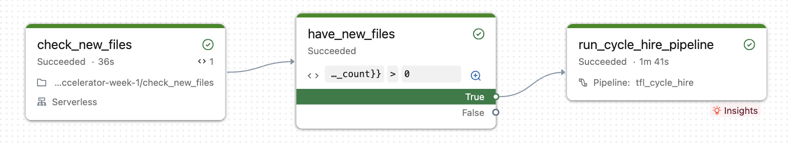
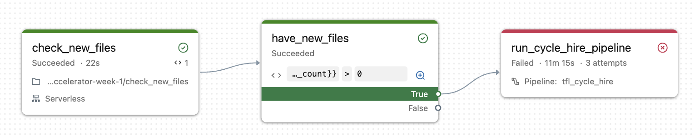
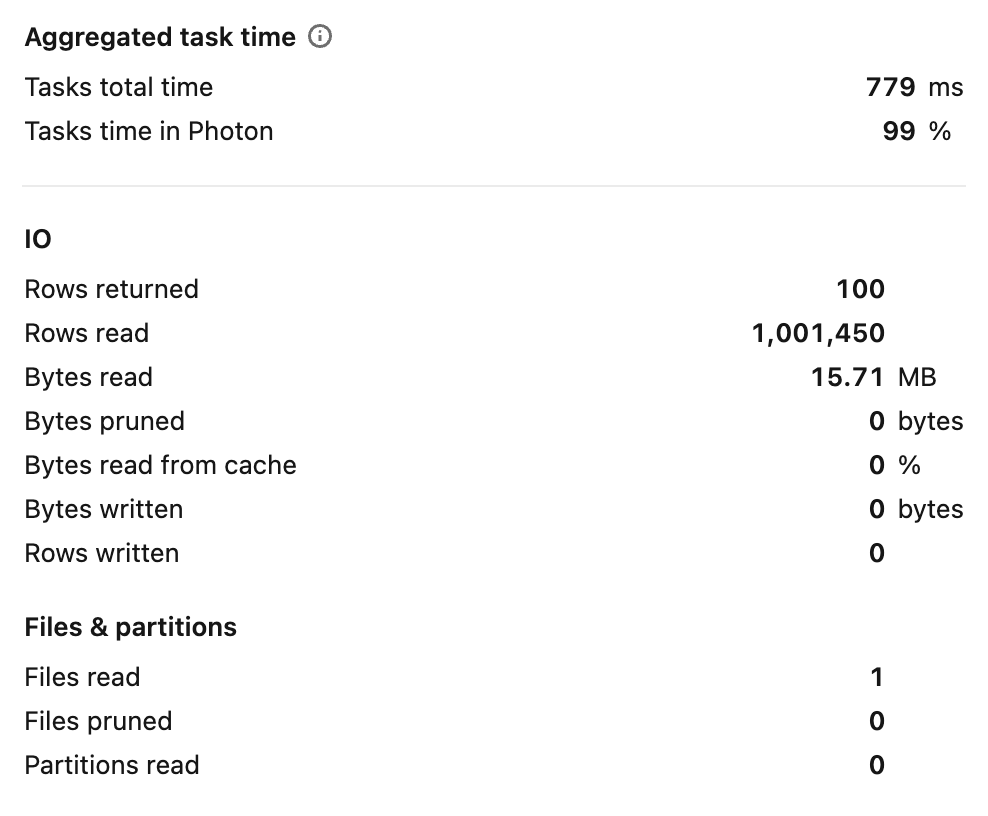
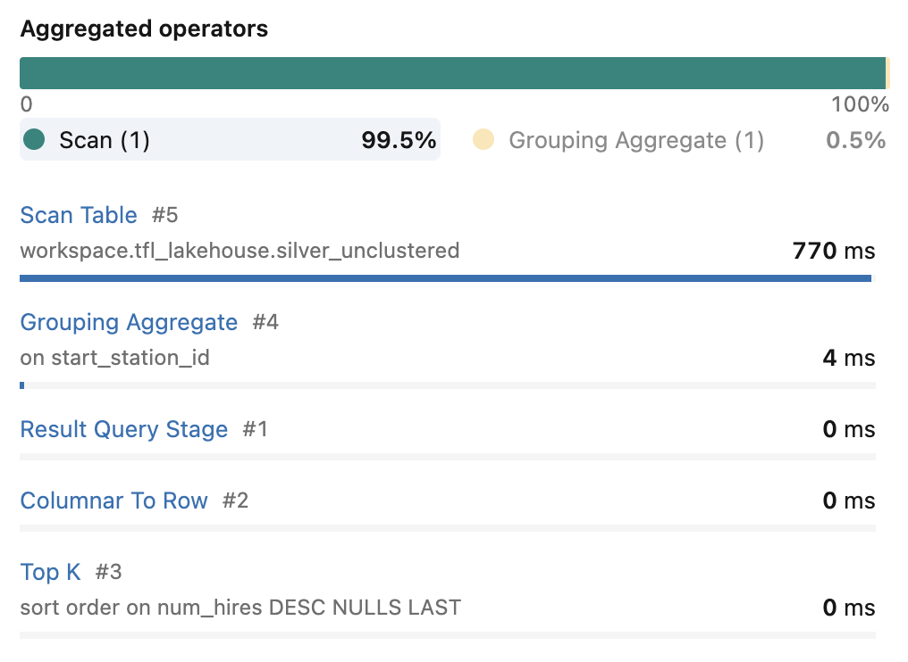
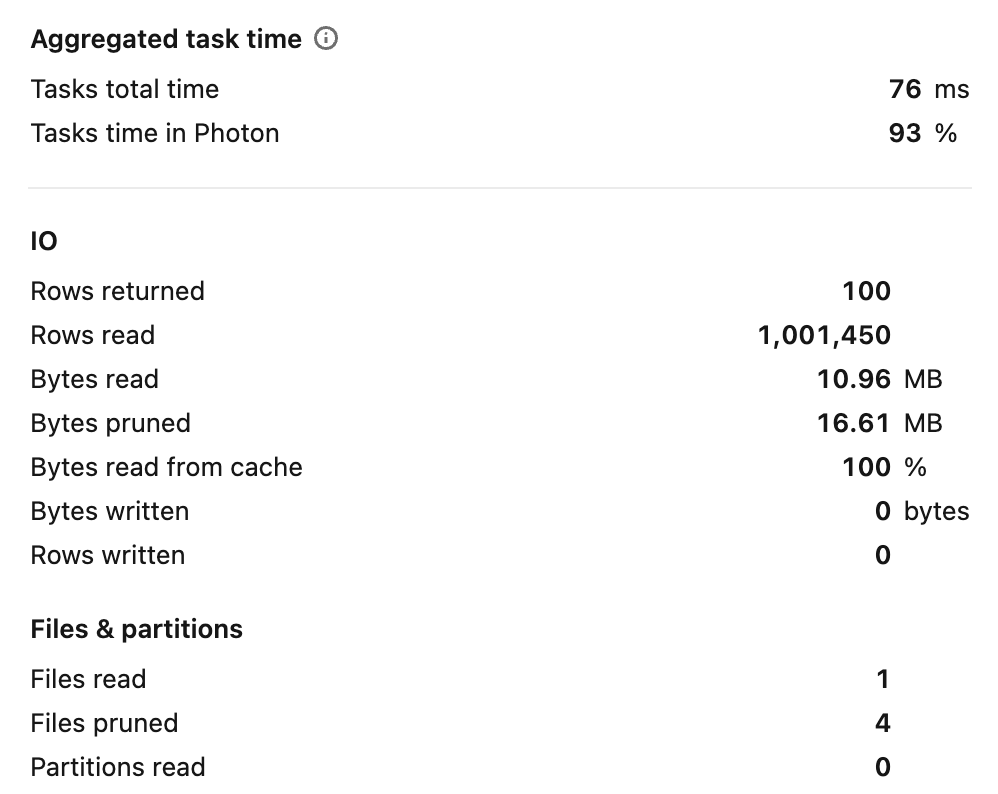
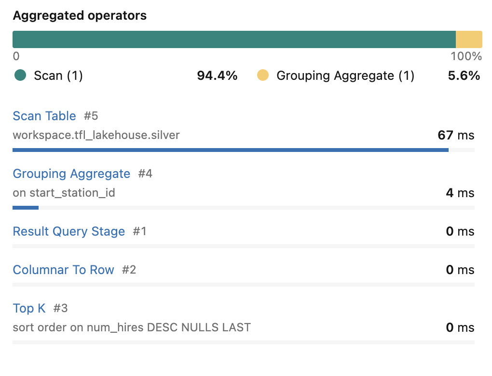
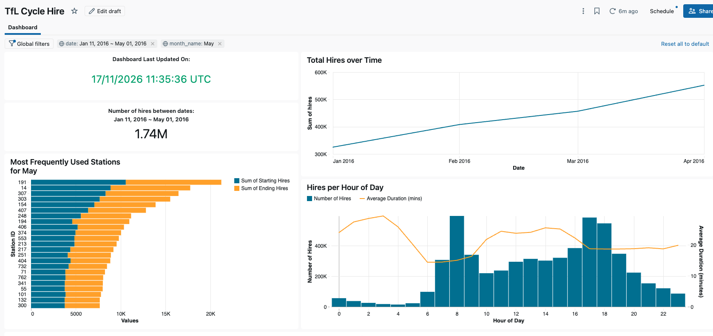
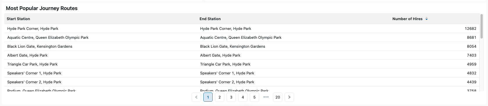
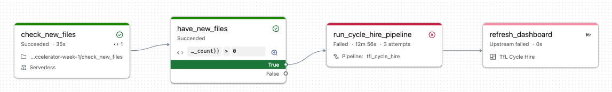
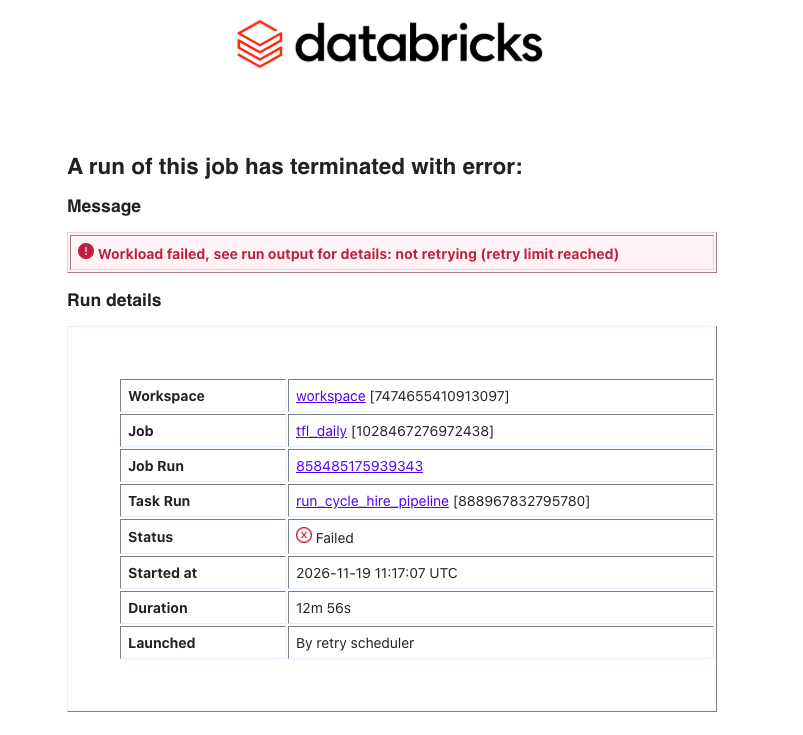

# Databricks Accelerator Project - TfL Cycle Hire

Journey files downloaded from https://cycling.data.tfl.gov.uk/ :

- 01aJourneyDataExtract10Jan16-23Jan16.csv	
- 01bJourneyDataExtract24Jan16-06Feb16.csv	
- 02aJourneyDataExtract07Fe16-20Feb2016.csv	
- 02bJourneyDataExtract21Feb16-05Mar2016.csv	
- 03JourneyDataExtract06Mar2016-31Mar2016.csv	
- 04JourneyDataExtract01Apr2016-30Apr2016.csv	
- 05JourneyDataExtract01May2016-17May2016.csv	
- 06JourneyDataExtract18May2016-24May2016.csv	
- 07JourneyDataExtract25May2016-31May2016.csv

## Data Issues
For cycle hire data from 2016
- Inconsistent column names in terms of capitalisation and spacing that make it harder to query column names
    e.g. 'End Date' vs 'EndStation Id'
- Incorrect data formats - all currently strings, should be ints for duration and ids, timestamps for start/end date etc.
    e.g. Start Date is currently string -> should be datetime, StartStation Id is also string -> should be int
- Several rows with null values for EndStation Id and EndStation Name in older files
- Duration given in seconds without clear indication; not compatible with newer files which give duration in ms and mins
- Min duration = 0 s which is invalid cycle hire
- Several empty columns which give no useful information (`_c9`, `_c10`, `_c11`)

## Expectations
Expectations were added to the pipeline to validate rows:
- `CONSTRAINT require_rental_id EXPECT (rental_id IS NOT NULL) ON VIOLATION FAIL UPDATE` to ensure rental_ids are present as primary keys - if not, then stop update 
- `CONSTRAINT positive_duration EXPECT (duration_minutes > 0) ON VIOLATION DROP ROW` to ensure duration is greater than 0, otherwise invalid hire
- `CONSTRAINT duration_under_24_hours EXPECT (duration_minutes < 1440) ON VIOLATION DROP ROW` to ensure duration is under maximum duration 24 hours, otherwise invalid journey/missing bike
- `CONSTRAINT needs_end_station EXPECT (end_station_id IS NOT NULL) ON VIOLATION DROP ROW` to only accept rows with end station otherwise invalid journey

## How to Run

Prerequisite: Download the specified files from __https://cycling.data.tfl.gov.uk/__ 
1. In your Databricks workspace, add this repository as a Git folder and open the notebooks.
2. Attach a running compute resource to each notebook.
3. Ensure the Unity Catalog objects `workspace.tfl` and the `raw` volume exist. Upload the source CSV files to `/Volumes/workspace/tfl/raw`. 
4. Run the notebooks in order: `01_explore`, `02_bronze`, `03_silver`, then `04_gold`. Use **Run all** in each notebook. The later notebooks read and write tables in `workspace.tfl`.


## Future Steps

In order to load next month's files and further tfl cycle hire files in future, a similar process should be set up to automatically ingest and transform new data.

1. Ingest the raw csv files into the bronze layer with an auto loader or using `COPY INTO`, making sure to fill in details such as the original source file name and time ingested to trace changes and loads.
2. Check the new data files for differences in column names/data formats/types that need to be cleaned and resolved before transforming data and joining with the silver layer. Use MERGE to update existing rows and insert new records without potentially introducing duplicates to silver layer table.
3. Rebuild gold tables to take new data into account
4. To set up a sustainable pipeline, set up a job to orchestrate the three steps in an automated workflow that runs every month when new data arrives


## Scheduling Jobs

I created a job scheduled to run each morning that would check for new files in the given volume and trigger the pipeline to ingest new data if present. Below are three runs under different conditions:

1. No new files - the check returns file_count of 0 so the pipeline is not triggered


2. New files - new .csv file added to volume so file_count is greater than 0 and pipeline is triggered to ingest, clean and process new data



3. Failure - I purposefully broke the pipeline so it would fail the job. It attempted two retries before ultimately failing. I used Repair Run to rerun only the last pipeline step after fixing the pipeline code.



## Performance

I introduced clustering based on the start_station_id column to speed up queries based on stations for common queries such as finding popular journey routes or stations. 

For example, this query used to find the busiest stations in the month of May 2016 was run with and without clustering on the start_station_id column:

```
SELECT
  start_station_id,
  COUNT(*) as num_hires
FROM
  silver_journeys
WHERE
  month(start_time) = 5
GROUP BY
  start_station_id
ORDER BY
  COUNT(*) DESC
LIMIT 100
```

Without `CLUSTER BY start_station_id`:



With `CLUSTER BY start_station_id`:



Clustering improved performance by grouping rows based on start_station_id and organising files so Databricks could skip files where start_station_id didn't match the min/max of each grouped file and filter/group necessary rows more quickly. 

## Dashboard and Analysis

I added a task to my scheduled job to refresh the dashboard to ensure new data is shown and ready for analysts. There is a counter on the dashboard which features the time that the dashboard was last updated, based on the last successful pipeline run, and this is coloured green if it was updated in the last 24 hours or red if the data is stale.

Questions Margot wants answered:
- How is usage changing over time and how does it compare with last week/month?
- Which stations are busiest?
- When are the busiest times for hires?
- How long are people hiring bikes for?
- What are the most common journey routes?

Screenshots of the Dashboard:




## Handling Failure

I uploaded a file with a different format and confirmed that the pipeline and job fail with a maximum number of 2 retries and a   a notification email sent out informing users of the failure. The relevant tasks can then be fixed and Repair Run used to rerun the failing tasks within the job.


